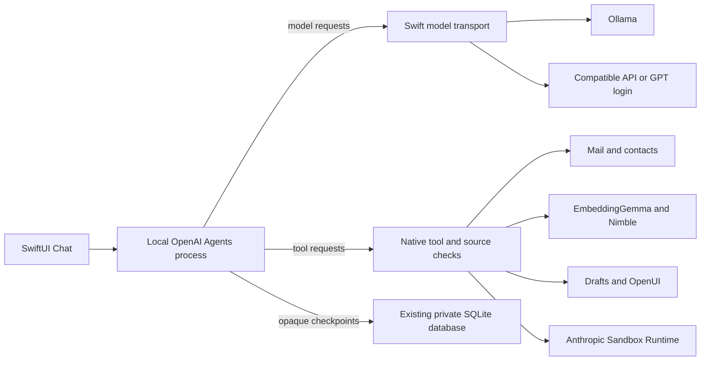

# Native Agent engine

Morrow's macOS Chat uses OpenAI Agents SDK 0.21.0.
The SDK owns the model/tool loop, specialist agents, sessions and resumable
approval interruptions. Tools provide virtual files and explicit task planning.
The native Swift app owns email
access, credentials, UI, model transports and application permissions.

## Tools

The native catalog currently contains70tools. `find_tools` discovers and loads
descriptions by purpose so the model does not receive every schema on every
request. Registered handlers remain available, subject to native checks.
Discovery controls the schemas shown to the model, while all registered handlers
remain bound in the SDK for checkpoint restoration. Discovered names are saved
with the session; older checkpoints recover names from actual tool invocations.

- Search, paged mail scans, paged body reads and exact metadata statistics.
- Native batch flags, labels, archive/trash and cross-page folder marking.
- Contacts, profiles, attachments, uploaded material and analysis.
- Draft creation, edits, rendered review, export, forwarding and calendar setup.
- Responses, continued work, memory, Chat sessions and presentation/model settings.
- Report publishing, OpenUI charts/forms and source citations.
- Brief lookup and reads. Saved briefs retain their originating Chat and message;
  replies link directly to the saved output. The Briefs view also opens earlier
  SDK outputs using persisted tool-call identities when available.
- Briefs separate summary, coverage/progress, findings, next actions,
  uncertainties and bounded tables. Tables use the native OpenUI renderer.
  Saving an output does not certify completion of the underlying task.
- Virtual file tools, structured planning and SDK specialist agents.
- Shell analysis through SRT with staged source evidence and no default network.

`review_send` opens a real draft for user review. It does not bypass the native
send workflow. Responders retain their separate exact-sender, account, folder,
authentication and delivery policy checks. Their policy loop is still native.

## Context and authority

UI state is a hint, not a retrieval ceiling. Explicit user scopes and accepted
work agreements remain native boundaries. Tool loading does not expand them.
Mail and attachments are evidence, never authorization. Unknown or forbidden
targets pause the run with an explanation and a user decision. Continuing
retains the same permissions. A failure cannot be described as a completed action.
Recoverable metadata-query mistakes return a typed correction without performing
the operation. The model can correct the query within the same scope; repeating
the same mistake after two corrections pauses for a user decision.

Search returns bounded candidates and snippets. Counts distinguish candidate
retrieval from mailbox totals. `scan_mail` and reading tools support pages;
unfinished sync/indexing is not presented as complete coverage.
Mail body pages default to6,000characters and clamp to4,000–8,000characters,
so the model cannot accidentally spend many turns reading tiny fragments.

## Storage and performance

- Model and mailbox credentials remain in Swift/Keychain, outside the SDK process.
- Hosted tracing is disabled; model traffic uses the user's selected provider.
- SDK checkpoints share the existing mail database, with a128MiB budget.
- Node's JavaScript heap is limited to256MiB; protocol and tool payloads are bounded.
- Default budgets are128model turns per agent segment,1,024shared tool calls,
  and60minutes per run. Settings allow up to512turns,4,096tools and240minutes.
  Specialist agents use the same turn allowance; their tools share the run budget.
- Turn exhaustion and tool failures save SDK state when available and ask the
  user before continuing. Timeouts preserve session material, the original task
  and its source constraints; a terminated in-flight operation has no guaranteed
  completion and must be checked before retrying.
- Native inference keeps its concurrency gate.
- Model text streams into a throttled progress preview; input composition is separate.
- OpenUI forms use SDK approval interruptions and resume the same run state.
- Plans and actual tool executions are displayed separately, with model and tool timings.
- Gateway and Ollama presets retain their own endpoint and model settings.
- SDK virtual files are not copies of the mailbox or a database backup.

The local macOS engine uses Node22.12or newer, installed or bundled. iOS retains
its Swift planner until a supported SDK execution host is configured. Apple
Intelligence continues to support native analysis; this SDK tool engine requires
a model with tool calling.

References: [OpenAI Agents SDK](https://developers.openai.com/api/docs/guides/agents/sdk),
[running agents](https://developers.openai.com/api/docs/guides/agents/running-agents).
