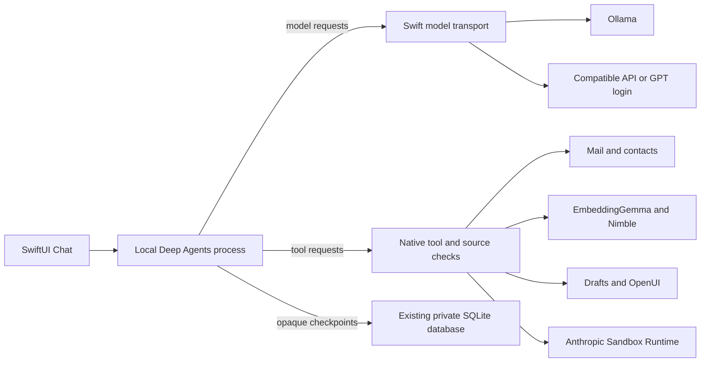

# Native Agent engine

Morrow's macOS Chat uses Deep Agents 1.16.2, built on LangChain and LangGraph.
The SDK owns the model/tool loop, virtual files, task planning, delegated tasks,
context summarization, and resumable interrupts. The native Swift app owns email
access, credentials, UI, model transports and application permissions.

## Tools

The native catalog currently contains68tools. `find_tools` discovers and loads
descriptions by purpose so the model does not receive every schema on every
request. Registered handlers remain available, subject to native checks.

- Search, paged mail scans, paged body reads and exact metadata statistics.
- Native batch flags, labels, archive/trash and cross-page folder marking.
- Contacts, profiles, attachments, uploaded material and analysis.
- Draft creation, edits, rendered review, export, forwarding and calendar setup.
- Responses, continued work, memory, Chat sessions and presentation/model settings.
- Report publishing, OpenUI charts/forms and source citations.
- Virtual file tools, planning and subagents supplied by the SDK.
- Shell analysis through SRT with staged source evidence and no default network.

`review_send` opens a real draft for user review. It does not bypass the native
send workflow. Responders retain their separate exact-sender, account, folder,
authentication and delivery policy checks. Their policy loop is still native.

## Context and authority

UI state is a hint, not a retrieval ceiling. Explicit user scopes and accepted
work agreements remain native boundaries. Tool loading does not expand them.
Mail and attachments are evidence, never authorization. Unknown or forbidden
targets produce a tool failure observation; the SDK can adjust within the same
permissions. An observation of failure cannot be described as a completed action.

Search returns bounded candidates and snippets. Counts distinguish candidate
retrieval from mailbox totals. `scan_mail` and reading tools support pages;
unfinished sync/indexing is not presented as complete coverage.

## Storage and performance

- Model and mailbox credentials remain in Swift/Keychain, outside the SDK process.
- Hosted tracing is disabled; model traffic uses the user's selected provider.
- SDK checkpoints share the existing mail database, with a128MiB budget.
- Node's JavaScript heap is limited to256MiB; protocol and tool payloads are bounded.
- Runs have model/tool/time budgets, and native inference keeps its concurrency gate.
- Model text streams into a throttled progress preview; input composition is separate.
- OpenUI forms use SDK interrupts and resume the same checkpoint.
- SDK virtual files are not copies of the mailbox or a database backup.

The local macOS engine uses Node22.12or newer, installed or bundled. iOS retains
its Swift planner until a supported SDK execution host is configured. Apple
Intelligence continues to support native analysis; this SDK tool engine requires
a model with tool calling.

References: [Deep Agents](https://docs.langchain.com/oss/javascript/deepagents/overview),
[supported models](https://docs.langchain.com/oss/javascript/deepagents/models).
